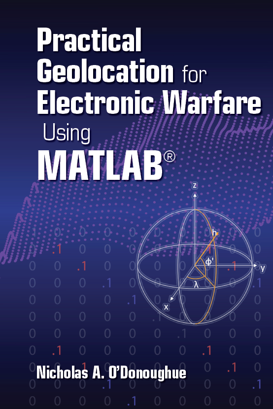

# Practical Geolocation forElectronic Warfare Using MATLAB

Practical Geolocation for Electronic Warfare Using MATLAB
This book delves into the complexities of real-world scenarios, including: working within different coordinate systems and converting between them, integrating relevant prior information about targets, sensor uncertainties, using multiple snapshots over time, and estimating the current position and velocity of moving targets. The e-book version described here includes links to multiple software and videos available from the public Git repository. These software and video resources can be downloaded from these sources. Additionally, this book contains all the MATLAB code required to develop novel algorithms that can be compared with classical techniques and enable you to address errors in sensor timing, position, speed, or direction.
The practical geolocation for electronic warfare discussed in this book explores the actual situations that arise when using geolocation for electronic warfare in real systems, including errors in target position, sensor position, direction, or velocity, as well as the impact of repeated measurements. The issues addressed by this book are directly related to accurate positioning and tracking of drones, aircraft, and ships.

## Images

<!-- PAYMENT_BLOCK -->

## Get this dataset

- Payment link (Stripe): [Buy now](https://buy.stripe.com/3cs8yP7sY87d0vu9AB)
- Payment QR code: 

<!-- /PAYMENT_BLOCK -->
